# Credit Risk Monitor

A dashboard that helps a bank's risk team see which loans are likely to go bad, why,
and what to do about it. It is built on 5 synthetic bank tables (10,000 customers and
14,685 loans) and has two AI features:

- **Ask the Portfolio:** ask a question in plain English and get an answer with real
  numbers from the data. It never makes up numbers.
- **Anomaly detection:** finds accounts that behave strangely, explains why, and lets a
  person confirm or dismiss each one.

**Live app:** https://credit-risk-monitor-romit.streamlit.app

**Demo video:** https://www.loom.com/share/8bc455aaf0cf4a05a02217574c66c635

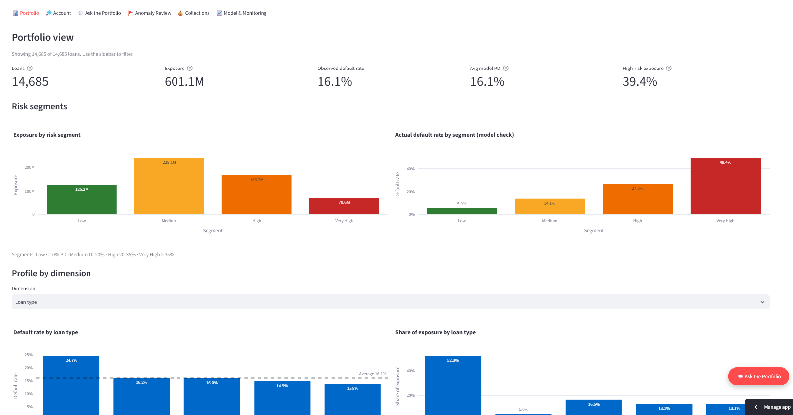

---

## 1. The problem

A bank lends money. Some customers stop paying. This is called a **default**.
In this data, **16.1% of loans defaulted**.

A risk analyst needs quick answers to four questions:

1. Where is the risk in our loans, and how much money is involved?
2. Why is this one loan risky?
3. Which accounts are acting strangely and need a look today?
4. Is our risk model still working?

This project answers all four in one place. Every loan gets a **risk score (PD)**: the
chance, from 0% to 100%, that it will default.

---

## 2. Results at a glance

| What | Result |
|---|---|
| Loans scored | 14,685 (10,000 customers, 601.1M lent) |
| Model quality (AUC, on customers the model never saw) | 0.66 (0.67-0.68 with 5-fold cross-validation) |
| Bad loans in the riskiest 20% of scores | 36.7% of all defaults |
| Money at risk in the riskiest 20% of scores | 59% of the real loss |
| Predicted vs real default rate | 15.7% vs 16.1% |
| Expected loss | 36.5M (6.1% of money lent), within 5% of the real loss |
| Accounts flagged as unusual | 981 (they default at 23.3% vs 15.6% for the rest) |
| Biggest finding | Mortgages: highest default rate (24.7%) and half of all money lent (52%) |
| Algorithms tested | 8 algorithms + 3 ensembles: all between 0.664 and 0.678, XGBoost best single model |
| Feature ideas tested | 15 extra features from Kaggle winners + 14 new bureau and combined features: no real gain |
| Simplest model that works | A 27-column logistic regression scores the same as XGBoost with 81 |
| Tests | 44 automatic tests, all passing |

---

## Screenshots

| Account view: why one loan is risky | Ask the Portfolio: a verified answer with its source |
|---|---|
| 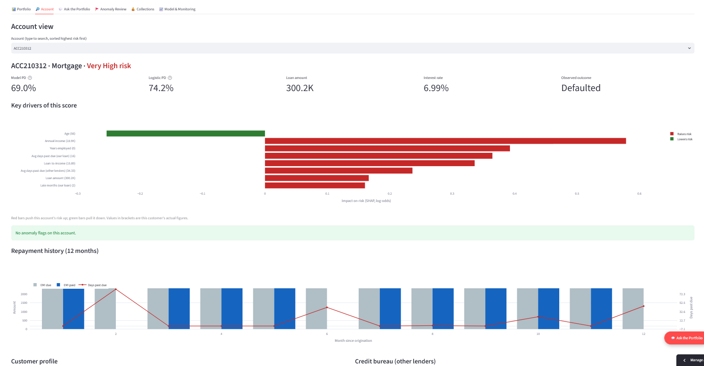 | 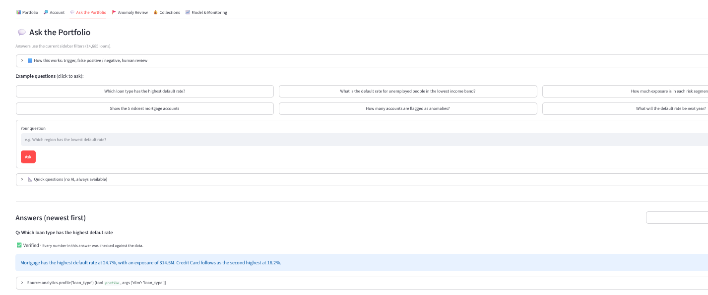 |

**Anomaly Review:** the reason for each flag, and the analyst's decision

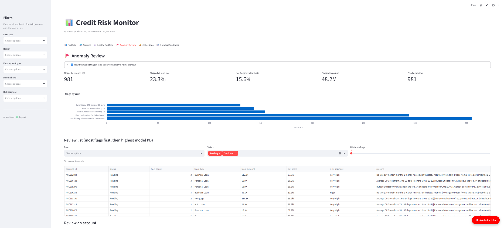

---

## 3. How to run it

**Python version:** 3.12.6

Three commands, from the project folder:

```
pip install -r requirements.txt
python src/build.py
streamlit run app/app.py
```

1. **Install:** installs the packages. Every version is pinned.
2. **Build:** cleans the data, trains the models, finds anomalies and works out the
   insights. Results go to `data/processed/` and `models/`. The original files in
   `data/raw/` are never changed.
3. **Start:** opens the dashboard at `http://localhost:8501`.

**Run the tests (optional):** `python -m pytest`. The tests use a fake AI, so they need
no API key and no internet.

### The AI key

The assistant uses **Google Gemini**. The free tier is enough.

- **On your computer:** copy `.env.example` to a new file called `.env` and add
  `GEMINI_API_KEY=<your key>`. Get a key at aistudio.google.com.
  `GEMINI_MODEL` is optional.
- **On Streamlit Cloud:** in the app settings, open **Secrets** and add
  `GEMINI_API_KEY = "<your key>"`.

The `.env` file is in `.gitignore`, so the key never goes to GitHub.

### What happens without a key?

The app still works. All charts, tables, the account view, the anomaly review and the
model tab work as normal. The AI part shows a message that it is off, and the
**Quick questions** still answer straight from the data.

If the AI service is busy, the app tries backup models. If none of them answer, it says
"AI unavailable" and the rest of the dashboard keeps working. It never crashes.

---

## 4. A tour of the dashboard

There are filters on the left (loan type, region, employment type, income band, risk
segment). They apply to every tab, including the AI answers.

A round **"Ask the Portfolio"** button floats at the bottom right of every tab, so the
AI is always one click away.

| Tab | Question it answers | What you see |
|---|---|---|
| **Portfolio** | Where is the risk? | Key numbers, money and default rate by risk group, default rate by any field, a heatmap of two fields together, trends by year, a list of loans in any group, and 5 key insights |
| **Account** | Why is this loan risky? | The risk score from both models, the top reasons (with the customer's real values), 12 months of payments, loans at other banks, other loans with us, and any flags |
| **Ask the Portfolio** | Can I just ask? | A question box, example questions, answers with a "Verified" badge and the exact source table, and quick questions that work without AI |
| **Anomaly Review** | Which accounts look strange? | A list of flagged accounts, the reason for each, a Confirm / Dismiss form, and a log of every decision |
| **Collections** | How do we get money back from late payers? | Which actions recover money, which customers pay, a cost calculator, and a suggested plan |
| **Model & Monitoring** | Is the model good, and still working? | Model scores, lift, calibration, top drivers, a drift check, a monitoring plan, and a fairness check |

**A normal day for an analyst:** check the key numbers, find the riskiest group in the
heatmap, open its loans, check why a loan is risky in the Account tab, then work through
the Anomaly Review list and record a decision for each account.

---

## 5. How it works

```
data/raw/*.csv       5 tables, never changed
      |
src/ingest.py        clean, summarize, join  ->  1 row per loan (14,685 rows)
      |
src/model.py         logistic regression + XGBoost  ->  risk score, risk group, reasons
src/anomaly.py       own history, similar customers, Isolation Forest  ->  flags + reasons
src/analytics.py     key numbers, profiles, insights (used by charts AND the AI)
      |
app/app.py           Streamlit dashboard, 6 tabs + floating AI button
      |
src/llm_assistant.py Ask the Portfolio (Google Gemini)
      |
Risk analyst         checks, confirms or dismisses  ->  decision log
```

`src/build.py` runs the first four steps in order.

---

## 6. The data

### What each file holds

| File | One row is | What it tells us |
|---|---|---|
| `customers.csv` | One customer (10,000) | Who they are: age, job, income, region, housing |
| `loan_accounts.csv` | One loan with us (14,685) | Loan type, amount, rate, length, and the answer we predict: `target_default` (1 = defaulted) |
| `bureau_credit.csv` | One loan at another bank (22,979) | How they behave elsewhere: open, closed or written off, and how late they pay |
| `repayment_history.csv` | One loan in one month (176,220 = 14,685 x 12) | How they paid our loan, month by month |
| `collections_events.csv` | One collection action (8,635) | Calls, messages and visits made when someone did not pay |

**How they connect:** each customer has 1 to 3 loans with us and 0 to 9 loans at other
banks. Every loan has exactly 12 months of payment history. 4,278 loans had at least one
collection action.

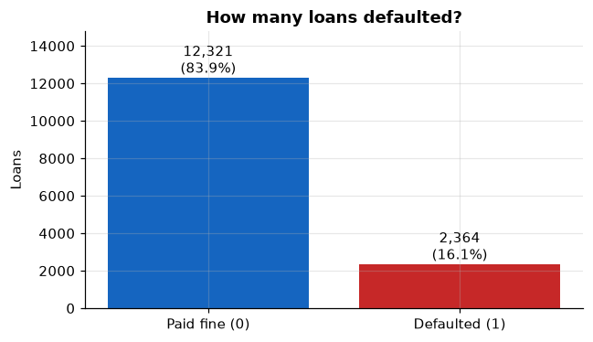

### What we found when checking the data

(Scripts: `src/profile_data.py`, `src/explore_data.py`, `src/deep_analysis.py`.)

- **The tables link cleanly.** No duplicate rows, no duplicate IDs, and every ID matches.
- **Missing values look random.** The default rate is about the same whether a value is
  missing or not, so filling them in is safe.
- **The dates do not line up across tables.** 45% of collection actions are dated before
  the loan even started, 62% of loans at other banks were opened after our loan, and
  7,293 loans start before the customer joined. So no date-based features are used.
- **No single field is very strong.** The best ones score "medium" on Information Value
  (0.10 to 0.17), and none is so strong that it looks like the answer is leaking in.
- **Payment status is consistent.** "Late" always means 1-28 days, "Missed" always means
  30-89 days, and "On-Time" always means 0 days.

---

## 7. How we prepared the data

### Joining the tables

The model predicts one answer per loan, so the final table must have **exactly one row
per loan**.

- We start from **loans**, because the answer (`target_default`) is there.
- **Payment history** (12 rows per loan) is first boiled down to one row per loan:
  months late, months missed, worst and average days late, whether it got worse over the
  year, and how much of each payment was made.
- **Loans at other banks** (many rows per customer) are boiled down to one row per
  customer: how many, how many written off, how late, and how much of their limit they use.
- **Customers** are added by `customer_id`.
- **Collections** are added for the dashboard only, **not** for the model (see section 10).

Every join keeps all loans. The code stops if a join would copy rows, and it checks at
the end that there are still exactly 14,685 rows.

**Why not join everything directly?** That would turn 14,685 loans into more than
176,000 rows, count each default 12 or more times, give extra weight to people with many
outside loans, and let the same loan end up in both the training and the test data.

### Cleaning decisions

Every decision is also saved in `data/processed/data_quality_log.csv`, with the number
of rows it touched. **No rows were deleted.**

| Problem | Rows | What we did | Why |
|---|---|---|---|
| Gender written as "M" / "F" | 600 | Changed to Male / Female | Same meaning, one label |
| More years in a job than possible for the age | 726 | Capped at age minus 16, and marked | The value cannot be true |
| Years employed, dependents, years at address missing | 500 each | Filled with the middle value for the same job type, and marked as "was missing" | Keeps every customer; the middle value is not pulled by extremes |
| Interest rate missing | 294 | Filled with the middle value for the same loan type, and marked | Rates differ a lot between loan types |
| Close date missing at other banks | 11,243 | Left empty | Not an error: these loans are still open |
| Days late missing at other banks | 689 | Left out of averages, and counted | Filling with 0 would make people look safer than they are |
| Loan starts before the customer joined | 7,293 | "Customer since" not used | The field cannot be trusted |
| Customer has no loans at other banks | 1,462 loans | Set to 0, and marked "no history" | Having no history is useful information |

---

## 8. Ideas we tested

Before building the model, we wrote down ideas about what causes default and checked
each one against the data.

| # | Idea | True or false? | What the data showed |
|---|---|---|---|
| 1 | Younger people default more | True | Under 30: 21.6%. Over 60: 6.8% |
| 2 | Lower income means more defaults | True | Lowest income group: 24.6%. Highest: 9.7% |
| 3 | Unemployed people default more | True | 35.0%, more than twice the average |
| 4 | People who have been in a job longer default less | True | Default drops steadily with years in a job |
| 5 | Missed payments warn of default | True | No missed months: 12.9%. Three missed: 33.5% |
| 6 | A loan written off at another bank warns of default | True, but weak | 18.7% vs 15.0% |
| 7 | If one of a person's loans fails, their other loans are riskier | True | 23.3% vs 14.6% |
| 8 | Loans backed by a house or car are safer | False | Mortgages default the most: 24.7% |
| 9 | Region affects risk | False | Every region is between 15.0% and 16.9% |
| 10 | The reason for the loan affects risk | False | Every purpose is between 14.9% and 16.9% |
| 11 | Riskier people pay a higher interest rate | False | Interest rate tells us almost nothing about risk (AUC 0.507) |
| 12 | Paying something during collections saves the loan | False | 22.0% vs 20.2% still defaulted |


### The ideas, as charts

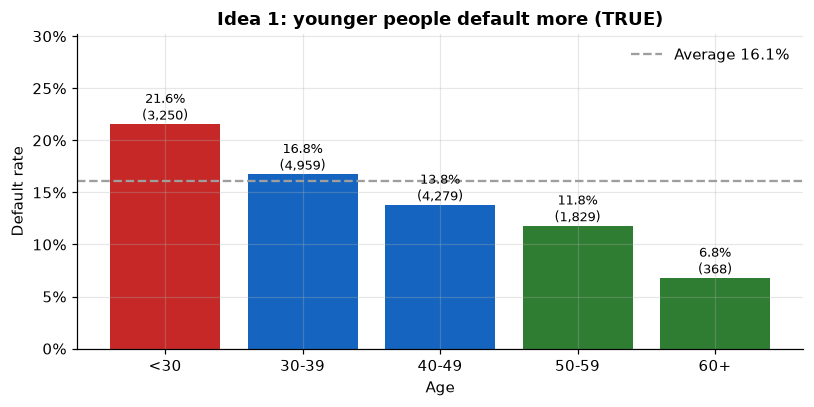

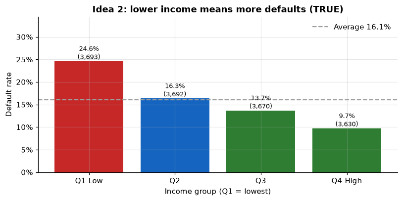

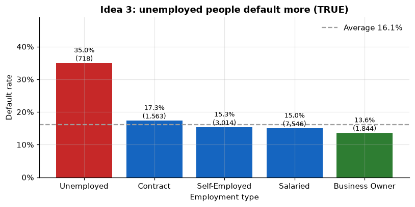

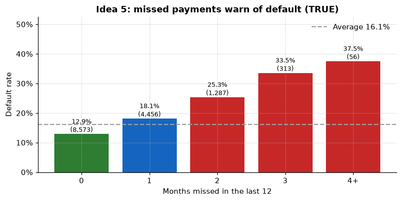

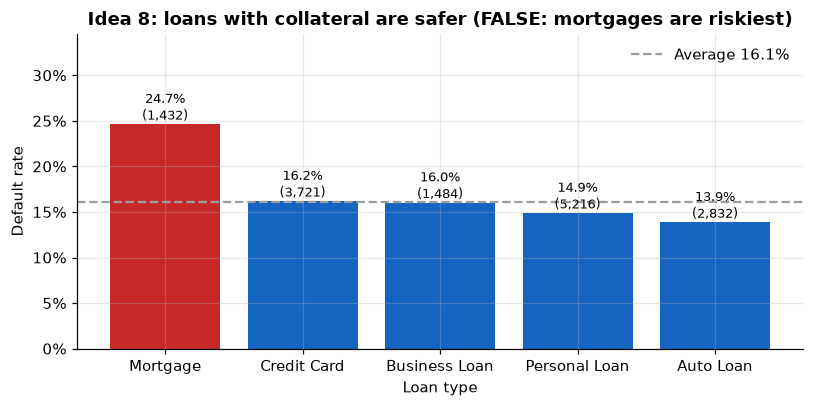

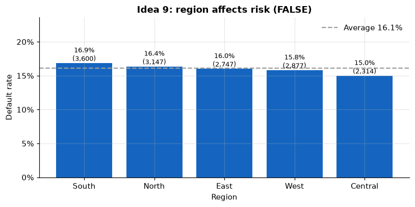

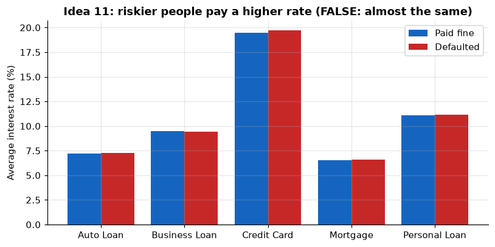

**Two fields together:** low-income contract workers and the unemployed stand out.

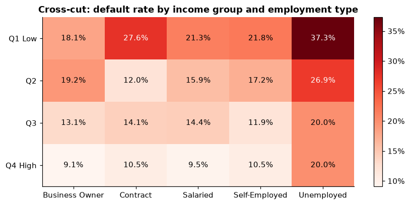

---

## 9. Feature engineering

A **feature** is one input the model learns from, like income or months missed.
**Feature engineering** means turning the raw tables into features that carry the signal.

### What we built from the raw tables, and why

| Group | Features | Why it should matter |
|---|---|---|
| **How they pay our loan** | Months late, months missed, worst and average days late, ever 30+ or 60+ days late | The most direct sign of trouble |
| **Is it getting worse?** | Lateness in the first 3 vs last 3 months, and the difference | A customer who is sliding is riskier than one who had one bad month long ago |
| **Recent trouble** | Missed payments in the last 3 months | Recent problems matter more than old ones |
| **How much they pay** | Share of each payment actually made | Paying only part is a warning sign |
| **Other banks** | Number of loans, open loans, write-offs, worst and average days late, limit, balance, share of the limit used | How they treat other lenders |
| **Can they afford it?** | Loan amount divided by yearly income | A loan that is large for the income is risky |
| **Thin file** | "No history at other banks" flag | Having no history is itself information |
| **Data gaps** | "Was missing" flags | Sometimes missing data is a signal |

### How strong is each feature?

We measured each feature with **Information Value (IV)**, the standard bank measure of how
well one feature on its own separates good loans from bad ones:
below 0.02 is useless, 0.02-0.1 is weak, 0.1-0.3 is medium, 0.3-0.5 is strong, and above
0.5 usually means the answer is leaking in.

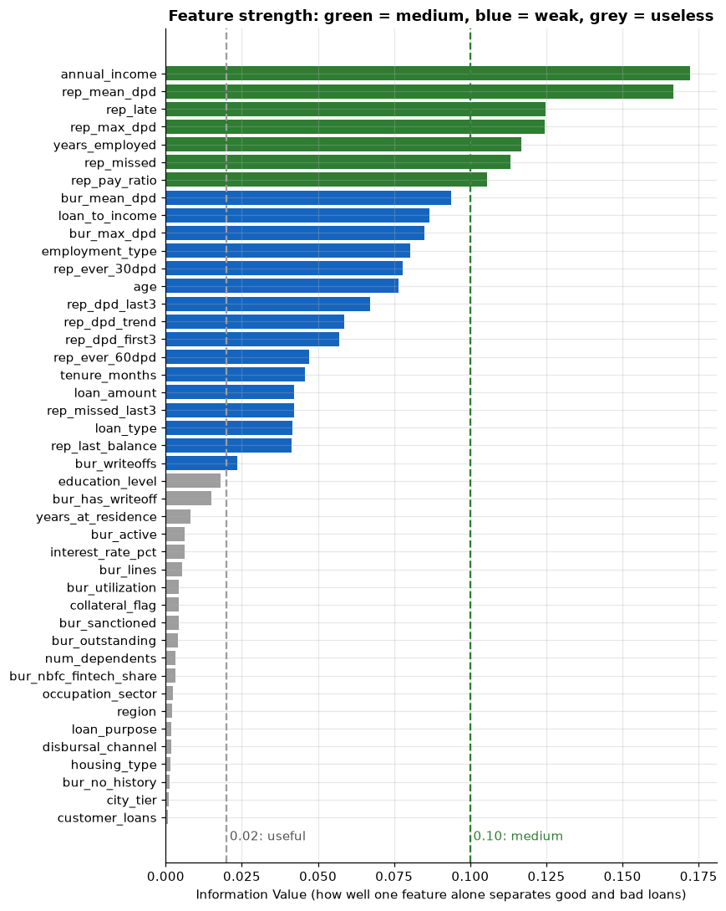

- **The strongest features are only "medium":** income (0.17), average days late (0.17),
  months late (0.12), years in a job (0.12) and months missed (0.11).
- **No feature is "strong", and none looks like leakage.** This is the main reason the
  model's score is moderate: there is no single powerful signal in this data.
- **Many features are useless on their own:** region, city tier, housing, loan purpose,
  sales channel, work sector, interest rate, number of dependents, and most features
  about loans at other banks (number of loans, limit, balance, share of limit used).

### Which features are near copies of each other?

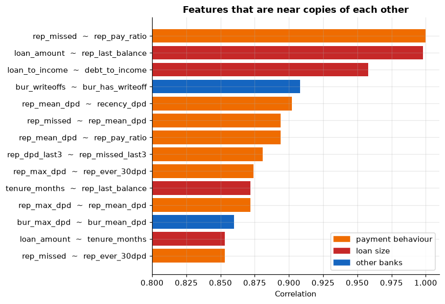

- **Payment features move together** (0.85 to 1.00). Months missed and share of payment
  made are exact copies, because a missed month means nothing was paid.
- **Loan size features move together** (0.85 to 0.998). Mortgages are big and long, so
  amount, length and balance all rise together.
- **Why it matters:** when features overlap, logistic regression splits the effect between
  them, so one weight can even flip sign. XGBoost and SHAP are not affected by this.

### Round 1: ideas from the winners of a Kaggle credit competition

We tested 15 extra features used by winners of the Kaggle Home Credit competition: more
weight on recent lateness, the longest run of late months, how often the status changes,
how much of the balance was paid off, debt compared with income, and others
(`src/deep_analysis.py`). With 5-fold cross-validation they added only **+0.002 AUC**,
which is less than the normal variation between folds (about 0.007). So none was kept.

### Round 2: what was still left in the raw data

We then tested 5 more ideas (`src/feature_engineering_v2.py`, output in
`reports/feature_engineering_v2.txt`):

| Idea | What we added | Strength on its own (IV) | Result |
|---|---|---|---|
| A. Other banks, by loan type | Write-offs on unsecured vs secured loans, share of money written off, card utilization, active loans 30+ days late | 0.002 to 0.028 | No real gain |
| B. Other banks, by lender | Worst lateness at fintech or NBFC lenders vs at banks | 0.039 to 0.068 | No real gain |
| C. Combined features | Unemployed x low income, young x low income, missed payments x unemployed, and others | 0.022 to 0.074 | No real gain |
| D. Clean scorecard | Removed useless features and exact copies | - | Same score with 27 columns instead of 81 |
| E. WoE binning (classic bank method) | 10 risk groups per feature, built on training data only | - | Same as normal logistic regression |

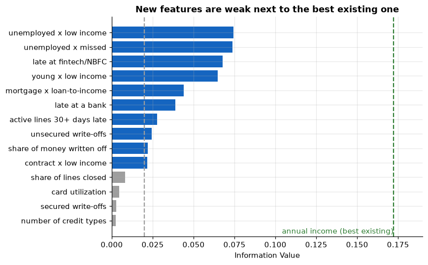

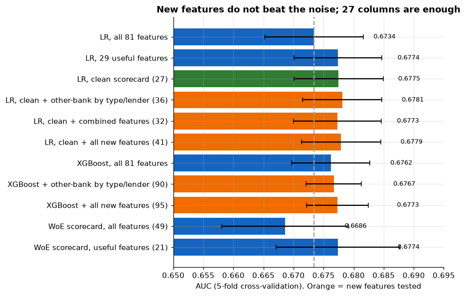

### What feature engineering taught us

- **No new feature is strong.** The best new one (unemployed x low income) has an IV of
  0.074, against 0.17 for income.
- **Being late at a fintech or NBFC lender** is a slightly stronger warning than being late
  at a bank (IV 0.068 vs 0.039).
- **Most features add nothing.** A logistic regression with just **27 columns** scores
  **0.6775**, the same as XGBoost with 81. The 27 are exactly what a credit expert would
  pick: income, age, years in a job, loan size and type, employment type, how they pay
  our loan, and lateness and write-offs at other banks.
- All gains were smaller than the noise, so the pipeline was kept simple.

---

## 10. The model

### What goes in

- **The loan:** amount, interest rate, length, type, purpose, how it was sold, whether
  there is collateral, and loan size compared with income.
- **The customer:** age, income, years in a job, dependents, years at address, job type,
  region, city tier, housing, education and work sector.
- **Payments on our loan (12 months):** months late, months missed, worst and average
  days late, ever 30+ or 60+ days late, share of each payment made, lateness in the first
  vs last 3 months, misses in the last 3 months, and money still owed.
- **Loans at other banks:** how many, how many open, how many written off, worst and
  average days late, total limit and balance, how much of the limit is used, and whether
  they have no history at all.
- The "was missing" marks.

Big money amounts are shrunk with a log (they vary hugely), and text fields are turned
into 0/1 columns.

### What is left out, and why

| Left out | Why |
|---|---|
| IDs | They mean nothing |
| Dates and "customer since" | They do not line up across tables |
| Gender and marital status | Fair-lending rules do not allow lending decisions on these. Removing them did not lower the model's score |
| All collections data | It would be cheating (see below) |

**Why collections would be cheating:** the bank only starts collections **after** a
customer stops paying. So collections are a result of the problem, not a warning sign.
The model's job is to spot risky loans early, so the bank can decide where to start
collections; using collections to do that would go in a circle. Collection actions also
depend on staff choices, so a change in bank policy would break the model. Collections
are still studied separately in the Collections tab.

### The two models

- **Logistic regression** (the baseline): simple, fast, easy to explain, and trusted by
  banks and regulators.
- **XGBoost** (the machine-learning model): hundreds of small decision trees, each one
  fixing the mistakes of the ones before. It uses small trees and stops early so it does
  not just memorize the training data.

### How we tested it

- **75% of loans to learn from, 25% to test on, split by customer.** All loans of one
  customer stay on the same side, so the model is never tested on people it has seen.
- **5-fold cross-validation** as a second, steadier check.

### Results (test set)

| Model | AUC | KS | Gini |
|---|---|---|---|
| Logistic regression | 0.6625 | 0.2563 | 0.3249 |
| XGBoost (used in the dashboard) | 0.6611 | 0.2434 | 0.3223 |

What these mean:

- **AUC:** pick one bad loan and one good loan. AUC is how often the bad one gets the
  higher score. 0.5 is a coin flip, 1.0 is perfect.
- **KS:** the biggest gap between how bad loans and good loans are scored. Higher is better.
- **Gini:** 2 x AUC - 1. Another common bank measure.
- **Why not accuracy?** Only 16% of loans default. A model that says "nobody defaults"
  would be 84% accurate and completely useless.

Other checks:

- With 5-fold cross-validation the AUC is **0.672** (logistic regression) and **0.676** (XGBoost).
- The riskiest 10% of loans default at **35.7%**; the safest 10% at **6.2%**.
- The risk groups rank in the right order: **Low 8.1%, Medium 15.3%, High 25.0%,
  Very High 39.0%**.
- Average predicted risk is **15.7%** vs a real default rate of **16.1%**, so the score
  can be read as a real chance.

### The model results, as charts

| ROC curve: both models are almost the same | Calibration: predicted risk matches real risk |
|---|---|
| 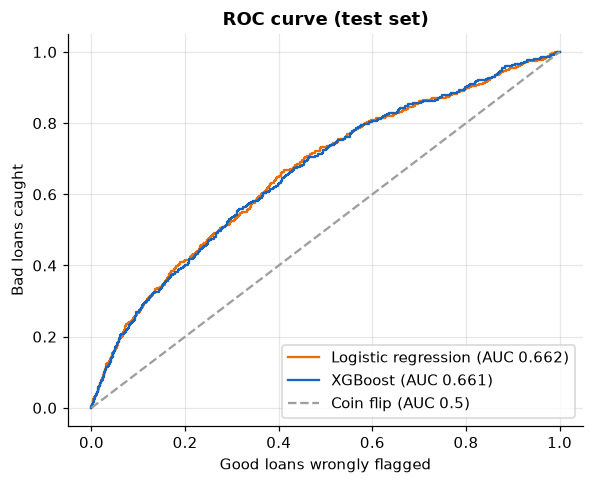 | 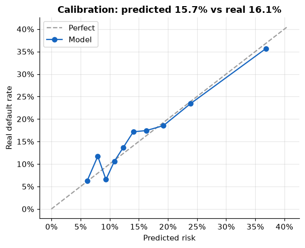 |

**Lift:** the riskiest score groups hold most of the defaults.

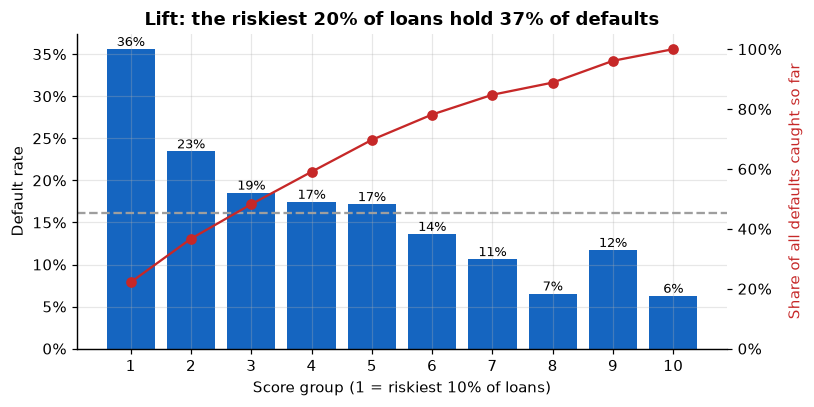

**Risk groups** on loans the model never saw:

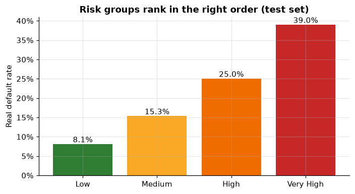

**Confusion matrices** at a 20% risk cut-off. *Caught* = bad loans flagged.
*False alarm* = good loans flagged. *Missed* = bad loans not flagged.

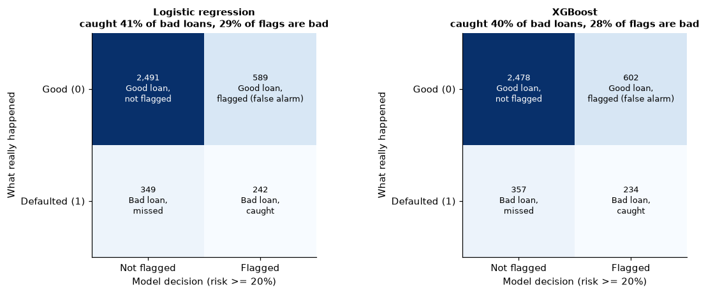

**What drives the score most** (SHAP):

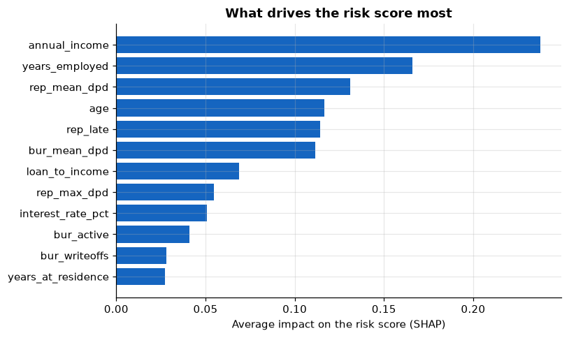

### Did we pick the right algorithm?

We tested 8 algorithms and 3 combinations ("ensembles") with the same features and the
same fair test: 5-fold cross-validation, split by customer (`src/benchmark_models.py`,
output in `reports/benchmark_models.txt`). The algorithms include CatBoost and LightGBM,
and Random Forest and ensembles, which ranked best in the largest published study of
credit-scoring algorithms (Lessmann et al., 41 algorithms on 7 real credit datasets).

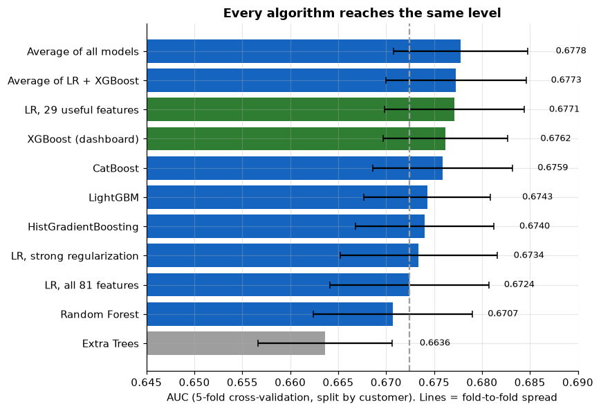

| Model | AUC | Spread between folds |
|---|---|---|
| Average of all models | 0.6778 | 0.0070 |
| Average of logistic regression + XGBoost | 0.6773 | 0.0073 |
| **Logistic regression, 29 useful features** | **0.6771** | 0.0073 |
| **XGBoost (used in the dashboard)** | **0.6762** | 0.0065 |
| CatBoost | 0.6759 | 0.0073 |
| LightGBM | 0.6743 | 0.0066 |
| HistGradientBoosting | 0.6740 | 0.0072 |
| Logistic regression, stronger regularization | 0.6734 | 0.0082 |
| Logistic regression, all 81 features | 0.6724 | 0.0083 |
| Random Forest | 0.6707 | 0.0083 |
| Extra Trees | 0.6636 | 0.0070 |

- **Every algorithm reaches the same level** (0.664 to 0.678). The gaps are smaller than
  the spread between folds, so they are noise. This matches the published study, where
  gains over logistic regression were usually small.
- **XGBoost is the best single model**, so it stays in the dashboard.
- **For a real bank, the 27-column logistic regression scorecard is the recommended
  production model:** same accuracy, much easier to explain and monitor.

### Why the score is moderate, and why all models score the same

- **We tried 29 extra features** in two rounds (section 9) and **8 algorithms** (above).
  Nothing moved the score by more than the noise.
- **No feature is strong.** The best ones are only "medium" (IV 0.17).
- The defaults the model misses look like **good customers in every table**: higher
  income, older, longer in a job, few missed payments. Whatever made them default (for
  example losing a job suddenly) is simply not in this data.
- When simple and powerful models all hit the same limit, the limit is in the data, not
  the method.

XGBoost is used in the dashboard because it gives clear reasons for each loan (SHAP). In
real use, the 27-column logistic regression would be the better choice: it scores the same
and is easier to explain.

---

## 11. Business value

The model is useful in money terms, not just as a score.

**Expected loss** = chance of default x share of money lost x loan amount.
We assume 45% of the money is lost when a loan without collateral defaults, and 25% for
mortgages and car loans (the house or car can be sold). Details: `src/business_value.py`,
output in `reports/business_value.txt`.

- The model expects a loss of **36.5M**, which is **6.1%** of the 601.1M lent. The real
  defaults would cost 38.4M, so the estimate is within about 5%.
- **Mortgages are half of the expected loss** (50.6%), then business loans (20.8%).
- **The loss is concentrated.** The riskiest 10% of loans hold 39% of the real loss,
  the riskiest 20% hold **59%**, and the riskiest 30% hold 71%.

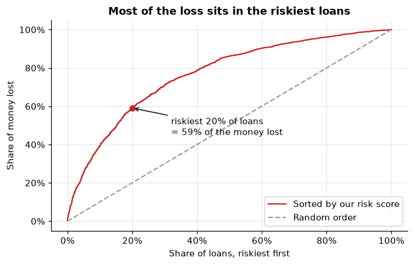

### Choosing which loans to review (test set)

| Review every loan with risk of at least | Loans to review | Bad loans caught | Money at risk caught | Reviewed loans that really are bad |
|---|---|---|---|---|
| 10% | 70.7% | 85.3% | 91.6% | 19.4% |
| 15% | 40.8% | 60.4% | 74.0% | 23.8% |
| **20% (High + Very High)** | **22.8%** | **39.6%** | **55.7%** | **28.0%** |
| 25% | 12.9% | 27.2% | 42.0% | 34.0% |
| 35% | 4.8% | 11.7% | 17.3% | 39.0% |

Missing a bad loan costs much more than one extra review. **We suggest a 20% cut-off:**
the team checks about a quarter of the loans and covers more than half of the money at
risk. With more staff, 15% covers three quarters of it.

---

## 12. AI feature 1: Ask the Portfolio

### How it works

1. The analyst types a question (in the Ask tab or with the floating button).
2. **First AI call:** Gemini sees only the question and a list of 7 approved tools (for
   example "default rate by a field" or "one account"). It sees **no data**. It picks a
   tool, or says the question cannot be answered.
3. **Python works out the numbers**, using the same code as the charts. So a chart and an
   answer can never disagree.
4. **Second AI call:** Gemini writes a short answer using only that small table.
5. **The code checks every number** in the answer against the table. If even one number
   does not match, the AI's text is thrown away and a safe answer written by code is shown.
6. The answer shows a badge (**Verified**, **Safe answer** or **Declined**) and the exact
   table it came from.

**What is sent to the AI:** the question, the tool list, and then one small summary
table. Never the raw customer data, and never the API key.

**What it answers:** totals, any number by one or two fields, one account, the riskiest
accounts, the anomaly summary and model quality. **What it declines:** forecasts, other
banks, opinions, general questions, and anything not in the data.

| | |
|---|---|
| **Trigger** | An analyst asks a question |
| **False positive** | It answers, but uses the wrong tool (for example city tier when you meant region). The source box shows which tool and table it used |
| **False negative** | It declines a question the data could answer. Rephrase it, or use a quick question |
| **Human step** | The analyst checks the badge and the source table before using a number in a report or a decision |

---

## 13. AI feature 2: Anomaly detection

### How it works

Each account is compared with **its own past** and with **similar customers** (same loan
type and income group). Every flag comes with a reason in plain English.

| Rule | Compared with | Flags an account when |
|---|---|---|
| Sudden miss | Its own past | No late payment in months 1-9, then a missed payment in months 10-12 |
| Lateness jump | Its own past | Average days late in months 10-12 is 30+ days more than in months 1-9 |
| High credit use | Similar customers | Use of credit limits at other banks is in the top 1% |
| Late at other banks | Similar customers | Days late at other banks is in the top 1% |
| Rare mix | All accounts | Isolation Forest marks the most unusual 2% |

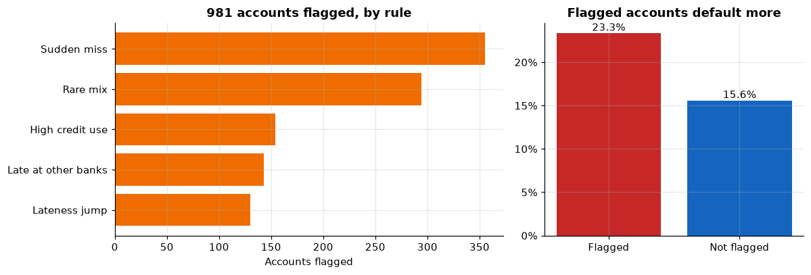

**981 accounts are flagged.** They default at **23.3%**, against **15.6%** for the rest,
so the flags point to real risk. The list shows the accounts with the most flags first.

| | |
|---|---|
| **Trigger** | Any rule above |
| **False positive** | A flagged account that is fine, for example one late month because a salary came late |
| **False negative** | A risky account that is not flagged, for example a slow decline that never crosses a line |
| **Human step** | The analyst reads the reason, checks the account, and chooses Confirm or Dismiss with a note. Every decision is saved with who made it and when. The system never acts by itself |

---

## 14. Collections (extra)

Collections data cannot go into the default model, but it is the right data for another
question: **once a customer is late, what gets the money back?** Banks often use three
different scores: one to approve loans, one to watch existing loans (this project's
model), and one for collections.

What the data shows (`src/collections_analysis.py`, Collections tab):

- **Every action works about the same.** Each one recovers money 23-27% of the time. Only
  settlement offers vs SMS/email is a real difference.
- **No customer group pays clearly more**, and the default model cannot predict who pays
  (AUC 0.49).
- **The data has problems.** 75.7% of actions marked "Payment Received" brought in no
  money, and actions often do not follow a logical order (only 44% go step by step).

**Suggested plan:** start with the cheapest actions and only step up when needed; use
settlement offers instead of SMS alone for bigger balances; build a separate collections
score; record outcomes from the payment system instead of typing them; and run fair tests
(give similar customers different actions and compare) to learn what really works.
The tab has a cost calculator; its costs are placeholders to replace with the bank's real
costs.

---

## 15. Top 3 insights

1. **Mortgages are the biggest worry.** They default at 24.7% (vs 16.1% overall), hold
   52% of the money lent and half of the expected loss.
   *So what:* review how mortgages are approved first.
2. **Income and age drive risk steadily.** The lowest income group defaults at 24.6% and
   the highest at 9.7%; under-30s at 21.6% and over-60s at 6.8%. Region hardly matters
   (15.0% to 16.9%). Low-income contract workers default at 27.6%, but only 12.0% one
   income group up.
   *So what:* set rules by the person's profile, not by where they live.
3. **The bank does not charge more for risk.** Interest rate alone predicts almost
   nothing (AUC 0.507); good and bad customers pay nearly the same rate.
   *So what:* the risk score could be used to set fairer, risk-based prices.

---

## 16. Watching the model after launch

The Model & Monitoring tab has a working drift check and this plan:

| What | How often | Warning sign | What to do |
|---|---|---|---|
| PSI: are new loans different from the training data? | Monthly | Above 0.10 watch, above 0.25 act | Look into it; retrain above 0.25 |
| AUC / KS on loans with a known outcome | Every 3 months | AUC drops by more than 0.03 | Retrain or tune |
| Predicted vs real default rate | Monthly | Gap above 2 points | Recalibrate |
| Default rate by risk group | Monthly | Groups stop ranking in order | Review the cut-offs |
| Data quality (missing values, new categories) | Every data load | Change above 5 points | Fix the data first |
| Fairness (predicted vs real by gender and age) | Every 3 months | Large gap | Review the inputs |

A person approves every retrain.

---

## 17. Assumptions

- The model scores **existing loans** that already have 12 months of payments. It is not
  for approving new customers.
- `target_default` was recorded after those 12 months.
- The data on loans at other banks is a current snapshot. That is fine for scoring
  existing loans, but not for approving new ones.
- Dates do not line up across tables, so they are not used.
- The money at risk is the original loan amount (a bank would use the current balance).
- 45% of the money is lost on a default without collateral, 25% with collateral.
- Income is yearly.

---

## 18. What a bank would need to use this for real

- **Data:** a daily feed of loans, payments and outside-loan data with dates that line
  up; the date of each default, not just yes/no; at least 24 months of history; outside
  data as it was on the approval date; collection results taken from the payment system;
  current balances and real recovery amounts.
- **Systems:** hosting inside the bank, single sign-on with user roles, a database for
  analyst decisions with a full audit trail, scheduled jobs to refresh scores, and safe
  storage for secrets.
- **AI:** a private or business version of the AI service that does not learn from bank
  data, a record of every question and answer, and a security review.
- **Rules and oversight:** an independent model check, a named model owner, a
  fair-lending review, and an approval step for any retrain or cut-off change.

---

## 19. Next steps

With more time and real bank data, I would:

1. Use the **current balance and real recovery data** to measure expected loss better.
2. Show the score as **points** (for example 300 to 900), which business users find easier.
3. **Save analyst decisions in a database**, so they are never lost.
4. **Learn from analyst decisions:** if a rule is often dismissed, adjust it.
5. Build a **separate collections score** to predict who pays once they are late.
6. **Test collection actions fairly**, by giving similar customers different actions.
7. Run the **monitoring checks automatically** every month, with alerts.
8. Teach the AI **more kinds of questions**, including follow-up questions.

---

## 20. Tests

`python -m pytest` runs 44 tests in the `tests/` folder. They check that:

- the final data has exactly one row per loan, clean labels and no impossible values;
- the cleaning and the 12-month summary work on small made-up examples;
- no collections, gender or marital-status data goes into the model;
- the model's scores are believable, are real probabilities, and rank in the right order,
  and no customer is in both the training and test data;
- every anomaly flag has a reason and only known rules are used;
- the AI catches a made-up number, declines off-topic questions, and does not crash with
  no key or when the service is down. These tests use a **fake AI**, so they run without
  internet.

---

## 21. Notes for reviewers

- Analyst decisions are saved to a CSV in `data/decisions/`. On Streamlit Cloud this file
  is cleared when the app restarts; a real system would use a database.
- Free Streamlit apps go to sleep after a while without visitors. Click "wake up"; no
  login is needed.
- The free Gemini tier may use questions to improve Google's products. The data here is
  synthetic, and only questions and small summary tables are sent.

---

## 22. Where each part of the brief is

| Brief item | Where |
|---|---|
| 1. Data loading, joins, cleaning decisions | `src/ingest.py`; output `data/processed/analytic_dataset.csv` and `data_quality_log.csv`; sections 6-7 |
| 2. Portfolio analysis and insights | `src/analytics.py`; Portfolio tab; sections 8 and 15 |
| 3. Default model, AUC / KS / Gini, SHAP | `src/model.py`; output `data/processed/model_metrics.json` and `feature_importance.csv`; sections 9-10 |
| 3. Monitoring plan | Model & Monitoring tab; section 16 |
| 4. Dashboard: portfolio view, account view, filters, drill-down | `app/app.py`, `app/views/portfolio.py`, `app/views/account.py`, `app/views/common.py` |
| AI feature 1: Ask the Portfolio | `src/llm_assistant.py`, `app/views/ask.py`, `app/views/ask_fab.py` (floating button); section 12 |
| AI feature 2: Anomaly detection and decisions | `src/anomaly.py`, `app/views/anomalies.py`; section 13 |
| Trigger / false positive / false negative / human step | "How this works" boxes in the Ask and Anomaly Review tabs; sections 12-13 |
| Architecture diagram | `docs/architecture.pdf` |
| Solution overview | `docs/solution_overview.pdf` |
| Tests | `tests/` (run with `python -m pytest`); section 20 |
| Extra: business value | `src/business_value.py`, `reports/business_value.txt`; section 11 |
| Extra: collections | `src/collections_analysis.py`, `app/views/collections.py`; section 14 |
| Extra: data checks and research | `src/profile_data.py`, `src/explore_data.py`, `src/deep_analysis.py`, `reports/` |
| Extra: feature engineering (rounds 1 and 2) | `src/deep_analysis.py`, `src/feature_engineering_v2.py`, `reports/`; section 9 |
| Extra: algorithm benchmark | `src/benchmark_models.py`, `reports/benchmark_models.txt`; section 10 |
| Charts and screenshots in this README | `assets/` (charts made by `src/make_readme_charts.py`) |

---

## 23. Folder layout

```
README.md
requirements.txt          pinned packages
.env.example              names of the keys, no values
pytest.ini                test settings
app/
  app.py                  dashboard entry point
  views/                  one file per tab, the floating AI button, shared helpers
src/
  build.py                runs the full pipeline
  ingest.py               clean, summarize and join
  model.py                logistic regression + XGBoost, scores, SHAP
  anomaly.py              anomaly rules and reasons
  analytics.py            key numbers, profiles, insights
  llm_assistant.py        Ask the Portfolio
  business_value.py       expected loss and review cut-offs
  make_readme_charts.py   creates the charts in assets/
  collections_analysis.py collections study
  benchmark_models.py     tests 8 algorithms and 3 ensembles
  feature_engineering_v2.py  tests new feature ideas
  profile_data.py, explore_data.py, deep_analysis.py   data checks
data/
  raw/                    the 5 CSV files as provided
  DATA_DICTIONARY.md
  processed/              results of build.py
models/                   trained models
reports/                  analysis results
assets/                   charts and screenshots for this README
tests/                    automatic tests
docs/
  architecture.pdf
  solution_overview.pdf
```